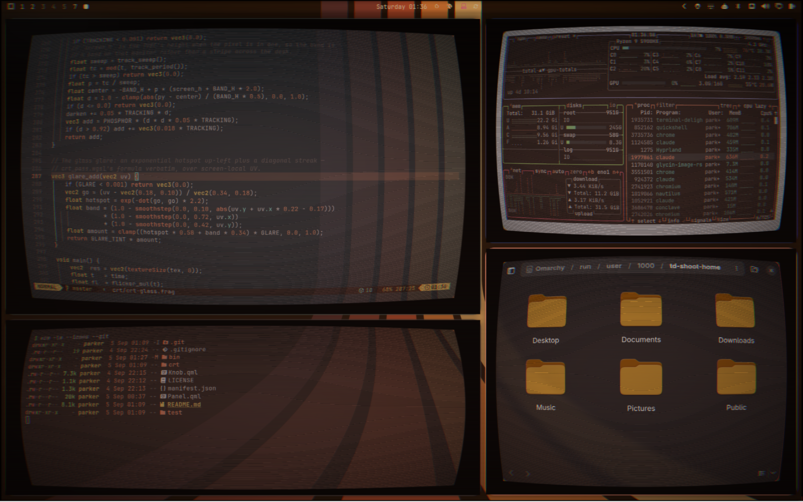
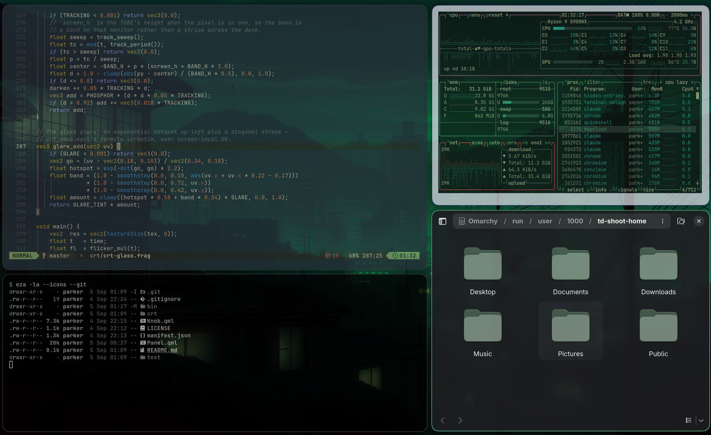

# Terminal CRT

**Delight-O-Matic** is the name on the front panel; the plugin is Terminal CRT,
sibling of [Terminal Paint](https://github.com/parker-brown-family/omarchy-td-palette).
Paint gives a terminal its theme; this gives the desktop its glass.

Curved glass, scanlines and a phosphor glow over the whole Omarchy desktop —
on **any** theme, with four knobs on the bar.



Same desk, different theme — nothing about the glass was touched in
between. The phosphor is the theme's own accent:



<!-- still wanted: the knob tray — open it on the staged scene and crop (docs/tray.png) -->

A CRT filter is a **lens**, and a lens is not a palette. This one used to ship
inside the `terminal-delight` theme, which meant you could own a curved monitor
only if you agreed to wear green: catppuccin, gruvbox, tokyo-night, nord and
every other theme were shut out of it for no technical reason anybody could
name. Twenty-two of the shader's twenty-four constants are optics — curvature,
aberration, scanline pitch, bloom, vignette, tracking, flicker, gamma — and
optics have no opinion about what colour your desktop is.

The two that *are* colours, `PHOSPHOR` and `GLARE_TINT`, now come from whatever
theme is staged. So gruvbox gets an amber tracking band and catppuccin a mauve
one, and both look right, because tinting the phosphor to the picture is what
phosphor tint is for.

## Install

```bash
omarchy plugin add https://github.com/parker-brown-family/omarchy-crt
```

Add **Terminal CRT** to your bar, then click the monitor icon. It wires
itself into Hyprland on first open — one file (`~/.config/hypr/crt.lua`) and one
`require()` line — or run `crt/crt install` yourself if you would rather watch.

Nothing else is needed. No packages, no compositor patches. If you want the
knob turns validated before they reach the screen, install `glslangValidator`
(`pacman -S glslang`); without it the renders go out unchecked and say so.

## The front panel

| Knob | What it turns |
|---|---|
| **BARREL** | how far the glass bows — `TUBE_K1`, `TUBE_K2` |
| **FADE** | the phosphor wash — `BLOOM`, `GLOW`, `VIGN` |
| **TRACKING** | the band that rolls down the picture — strength *and* speed: down is 40% slower, up is 10% faster |
| **SCANLINE** | the line structure — `SCAN` |

Grab a knob and turn it — it accumulates the angle you sweep, from wherever the
knob already is, the way a knob does. The wheel is the fine adjustment. Arrow
keys work when the tray has focus: left and right pick a knob, up and down turn
it.

There is no phosphor dial, deliberately — see the top of this file. Behind
**SERVICE PANEL** are five more: convergence, flicker, glare, room light,
jiggle. The rest of the tube has ranges a dial would lie about (scanline pitch
in pixels, band height, rest seconds, the colour grade), so those live on the
command line.

## The command line

```bash
crt
```
```bash
crt set BARREL 0.7
```
```bash
crt set SCAN 0.35 SCAN_STEP 3
```
```bash
crt quiet off
```

A knob you set by hand outranks the macro that would otherwise cover it, until
you turn that macro again. `crt` on its own prints both tiers and where every
file lives.

## Switching it off

**SUPER + CTRL + SHIFT + L**, with or without ALT, switches the whole CRT off,
and again switches it back on — L for gLass. So does the **power button** at the top of the tray, a
right-click on the bar icon, or:

```bash
crt toggle
```

Off means the whole set, not a sheet of plain glass over one still running: the
tube watcher stops, the screen shader goes to a passthrough, damage tracking and
the cursor go back to Hyprland's defaults, and a config reload while it is off
binds the passthrough rather than the glass. Nothing is uninstalled. Your knobs
are kept, the watcher stays enabled and simply declines to start at login while
the switch says off, and switching back on brings the tubes back.

This replaced a *lift* that only swapped in the passthrough, and that turned
out to be three things still binding a shader at once — this plugin's own
watcher on every focus change, the glass coming back at every reload, and the
terminal-delight theme's `td-tubes` binding its glass on every layout event. The
last of those is why the switch also stops `td-tubes.service` if it finds it
running, in either direction: two programs binding one screen shader do not
error, they take turns, and on a desktop that looks like tiles flickering
between warped and flat as the pointer crosses them.

## Flat toasts: the native pass (optional)

A screen shader runs after everything is composited, so toasts and menus bend with the tiles under them. The native pass is a small Hyprland plugin that runs the same shader earlier, after windows and before overlays, so they stay flat over curved tiles. Tile moves stop freezing the desktop too, because nothing recompiles.

```bash
native/build
```
```bash
crt native on
```

It loads into the running session only, and nothing goes in your config, so a reboot or a crash comes back on the screen shader. `crt native off` takes it out. The tray, the knobs and the hotkey work the same either way. The bar and overlays are drawn after the CRT, so they lose the scanlines and glow.

It runs inside Hyprland, so a bug can take your session down. It is built against one Hyprland commit and refuses a different one. That check can't see a change in a library Hyprland depends on, so run `native/build` again after any Hyprland or dependency update. It isn't part of the Omarchy plugin install.

Building it needs the Hyprland headers (`pkg-config hyprland`) and g++. The plugin is built on your machine from the source here, and no binary ships in this repository. Hyprland runs it with your full user permissions, unsandboxed, so read `native/crt-pass.cpp` before you load it.

## How it works, and the two things worth knowing

**Hyprland screen shaders take no uniforms**, and there is no IPC to set one. So
changing a setting means rewriting the shader's `const` block and recompiling —
a few milliseconds, no relogin. The mistake worth not repeating is doing that
rewrite *in place*: the file then carries both the defaults and your settings
and the two can no longer be told apart. Here the template under `crt/` is
read-only, your settings live in `$XDG_STATE_HOME/omarchy/crt/knobs.json`, and
the shader beside them is a build output you can delete at any time. It is
deliberately NOT in `~/.config/hypr/shaders/`, which the terminal-delight theme
and td-tubes already share.

That is also why there is no rule about not committing your window layout. The
tube data is runtime state, it lives in state, and there is no path from a
window being open to a line in a commit.

**Motion costs damage tracking, and it ships off.** Hyprland treats any screen
shader that *declares* `uniform float time` as animated — the warning keys off
the declaration, not the use — so the whole screen redraws every frame instead
of just what changed. The still glass therefore compiles no clock at all, even
though TRACKING and FLICKER sit above zero: the band is configured and
deliberately frozen, and a fresh install is silent.

Turning TRACKING, FLICKER or JIGGLE above zero starts it, and taking the last of
them back to zero stops it. The plugin moves `debug:damage_tracking` between
three tiers to match:

| state | tier | what it costs |
|---|---|---|
| clock running | 0 | the whole screen redraws every frame — Hyprland's red banner names this price, and it is real |
| still glass, tubes up | 1 | a change repaints its whole monitor; an idle monitor draws nothing |
| switched off | 2 | Hyprland's default |

Tier 1 is the quiet discovery: the gather only ever needed "repaint the whole
monitor when anything changes", not "repaint everything always" — so a still
glass keeps damage tracking on and costs next to nothing at idle. The banner —

> Screen shader uses uniform 'time', which requires debug:damage_tracking to be
> switched off.

— belongs to the clock alone. It is not a grumble about a choice you already
made: the motion will not repaint until tier 0 is set, so the plugin sets it
when you start the clock and hands it back when you stop.

## Where the pieces are

| | |
|---|---|
| `Panel.qml` | the bar icon and the tray |
| `Knob.qml` | one dial — canvas face, angular drag, wheel |
| `PowerButton.qml` | the switch at the top of the tray |
| `crt/crt-glass.frag` | the template, never written to |
| `native/` | the optional Hyprland plugin and its sealed test seat |
| `crt/crt` | render, knobs, tubes, install |
| `crt/crt-tubes.service` | the watcher that keeps the rects true |
| `bin/shoot` | stages a workspace and photographs it — never the live desktop |
| `test/run` | the suite — a sandboxed HOME with `hyprctl` and `systemctl` stubbed |

## Tubes: one per surface, or none

Each visible surface gets its own rect, and the shader bends every pixel through
whichever rect contains it. That is only safe while **every** surface claims
one — a region nobody claims falls through to whatever rect is underneath and
gets drawn through its neighbour's map, bent and offset and seamed.

Which is why there is a watcher and not a snapshot:

```bash
crt tubes watch
```

or, under systemd, for the whole session:

```bash
crt install
```

`crt install` is what writes that unit and enables it. Enabling it by hand is
not a shortcut past this — there is nothing to enable until the install has
written it, and what the install writes is a unit that will not start unless
the guard below says the plugin is still there.

Layer surfaces are what make the distinction matter. A tray, a menu, a
notification and the lock screen each exist for a few seconds, so none of them
can appear in a list written before they opened — and each one comes up bent
over whatever window it happens to cover. Watching turns that into an
`openlayer` event and a rect.

### The screen you are not looking at

A monitor with nothing changing on it gets no frames — Hyprland renders on
damage, not on vsync — so anything the clock drives stops where it was. The
tracking band strands mid-screen and stays there until something else repaints
that monitor, which behind a bar clock reading `HH:mm` can be most of a minute.

There is no event for "this monitor stopped rendering" and no way to ask, so the
rule is the one thing Hyprland does tell you: **tubes on a monitor without focus
go quiet.** The band and the flicker stop; the scanlines, curve and vignette
stay, because they do not move and a frozen frame of them is identical to a live
one. Turn it off with `crt quiet off`.

What makes the wipe possible at all is that you cannot paint a correction onto a
monitor that has stopped rendering — but *changing the shader is what causes a
render*. The swap carries its own frame.

`crt render` **refuses to splice rects while nothing is keeping them
true** and renders flat glass instead, which is merely less pretty. The watcher
also flattens on its way out, so stopping it leaves a plain desktop rather than
the last layout's rects bending whatever moved in. `CRT_TUBES_ANYWAY=1`
overrides, for someone who has read this paragraph and disagrees.

The geometry — rotation transforms, per-monitor scale, layer surfaces, the
fullscreen occlusion rule, a whole-monitor budget — lives in
`crt/tubes-geometry`, a **generated** copy of the terminal-delight theme's
`td-tubes`, produced by `bin/sync-tubes-geometry` and changed no other way. The
theme's file stays the single place that logic is edited; the plugin carries
its own copy so it runs with no theme installed at all, and
`bin/sync-tubes-geometry --check` says whether the copy has gone stale.
`test/probe-fullscreen-layer` proves the copy against a stubbed compositor,
occlusion rule included. `crt install` puts the watcher under systemd for you.

The optics are a port of [terminal-delight](https://github.com/parker-brown-family/terminal-delight)'s
own display stack, dial for dial.

## Removal, and what happens if you skip the tidy version

```bash
omarchy plugin remove brownfamilysports.crt --yes
```

`crt uninstall` is the tidy exit and takes the Hyprland wiring, the theme-set
hook, the systemd unit and the guard back out itself, each only if it still
carries this plugin's marker; anything that has since become somebody else's is
left where it is and named on stderr. It also unloads the native pass if it is on
and deletes the native builds in this plugin's own state directory. If Hyprland
will not unload the pass, it stops there and removes nothing.

**You do not have to remember to run it.** A screen shader has to be named in
Hyprland's config, a theme switch has to reach omarchy's hook directory and a
watcher has to be a systemd user unit — so three files outside this checkout
point back at it, and `omarchy plugin remove` deletes the checkout while running
nothing of ours on the way out. It has nothing to run: omarchy's hook directory
carries `theme-set.d`, `font-set.d`, `post-boot.d`, `post-update.d`,
`battery-low.d` and `pre-refresh-pacman.d`, and nothing at all for a plugin being
added or removed.

So the registrations are built not to need cleaning up. Each one calls
`$XDG_STATE_HOME/omarchy/crt/crt-guard` before it does anything, and the guard
checks the plugin is still there and is still this plugin — the unit through
systemd's own `ExecCondition=`, the theme hook as its first line. When the
plugin is decisively gone, or a different plugin has taken its pathname, the
guard removes every registration this plugin made, itself included, and refuses
to run. A pathname recreated later by something else is never executed.

The native pass is the one thing the guard cannot reach straight away, because it
draws from inside Hyprland and nothing of ours runs at removal. If you remove the
plugin with it on, the warp stays until the next thing that reaches the guard (the
hotkey or a theme switch), which unloads it, or until you log out. If the unload
fails, the guard leaves everything in place and tries again next time. `crt native
off` before removing avoids the wait.

Decisively is doing work in that sentence. A checkout that is *there but
unreadable* is what a half-finished `omarchy plugin update` looks like from the
outside, and it is not a removal: the guard refuses to run and deliberately does
**not** disarm, so an update that takes its time cannot cost you your wiring.

Your knobs in `$XDG_STATE_HOME/omarchy/crt/` are deliberately left either way, so
a reinstall picks up where you left off — delete that directory to forget
everything.

## Dependencies

Everything the glass needs ships in the repository or with Omarchy itself:
`python3`, `hyprctl`, `jq` and `bash` are already on an Omarchy box.
`glslangValidator` (`pacman -S glslang`) is optional and recommended — with it,
a knob turn that would not compile never reaches your compositor.

MIT.
